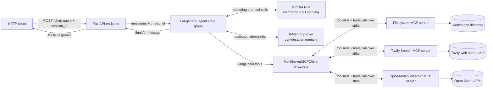
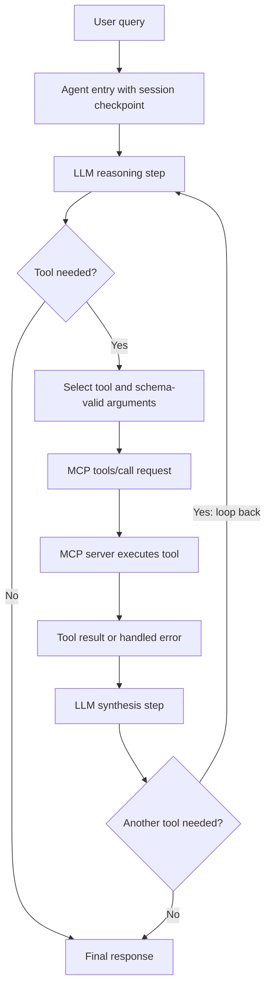
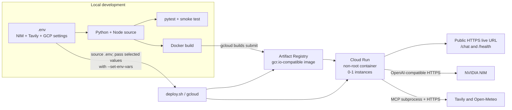

# CSCI 599 Assignment 1 - Tool-Using Agent with MCP

This project is a Cloud Run-ready conversational agent built with FastAPI, LangGraph,
NVIDIA NIM, and three real Model Context Protocol (MCP) servers. The agent can decide
when no tool is needed, select a suitable tool, chain multiple calls, and remember earlier
turns within a `session_id` while the Cloud Run instance remains alive.

## What is implemented

- `POST /chat` with the required `{ "query", "session_id" }` contract.
- NVIDIA NIM through its OpenAI-compatible endpoint; the model is environment-configurable.
- LangGraph `InMemorySaver`, keyed by `session_id` as `thread_id`.
- Three MCP servers discovered and called through `tools/list` and `tools/call`:
  - official filesystem MCP, restricted to `workspace/`;
  - official Tavily search MCP;
  - student-authored Open-Meteo weather MCP.
- Per-server discovery isolation, tool-error propagation, request timeout handling, and
  graceful responses for transport or malformed-response failures.
- Pinned Python/npm dependencies, non-root multi-stage Docker image, tests, and deployment
  automation.

## API contract

```http
POST /chat
Content-Type: application/json

{
  "query": "Search for USC news and save a short summary to news.txt",
  "session_id": "demo-session"
}
```

```json
{
  "response": "I searched for current USC news and saved the summary to news.txt."
}
```

`GET /health` reports whether the agent initialized and lists the tools discovered from
each MCP server. Interactive OpenAPI documentation is available at `/docs`.

## Local setup

Prerequisites: Python 3.12+, Node.js 22+, and an NVIDIA NIM developer key. A Tavily key is
strongly recommended for reliable grading, although the current Tavily server offers a
rate-limited keyless search mode.

```bash
python3.12 -m venv .venv
source .venv/bin/activate
python -m pip install -r requirements-dev.txt
npm ci --ignore-scripts
cp .env.example .env
```

Edit `.env` and replace the placeholder values. Never commit `.env`.

```bash
python main.py
curl http://127.0.0.1:8080/health
curl -X POST http://127.0.0.1:8080/chat \
  -H 'Content-Type: application/json' \
  -d '{"query":"What is the weather in Los Angeles?","session_id":"local-1"}'
```

Run automated verification:

```bash
pytest -q
python scripts/smoke_test.py http://127.0.0.1:8080
```

The pytest suite verifies the HTTP schema, session-to-thread routing, real `tools/list`
against all three servers, a real filesystem `tools/call` write/read round trip, built-in
LangGraph memory isolation, invalid tool inputs, timeouts, and unavailable-server recovery.

## Cloud Run deployment

Install and authenticate the Google Cloud CLI, then select the USC-billed project. The
script enables Cloud Run and Cloud Build, builds the image, deploys one scale-to-zero
instance in `us-west1`, and prints the live URL.

```bash
gcloud auth login
# Put GCP_PROJECT_ID, NIM/Tavily keys, and the remaining values in .env.
./deploy.sh
python scripts/smoke_test.py https://YOUR-SERVICE-URL.run.app
```

`--max-instances 1` is intentional: Assignment 1 permits instance-lifetime memory, and a
single instance avoids splitting sessions across independent in-memory checkpointers.
Memory can still disappear after scale-to-zero or an instance replacement, as allowed by
the assignment.

To make the submission ZIP without secrets or bulky generated directories:

```bash
./scripts/package_submission.sh
```

## Cost disclosure

This service calls NVIDIA NIM and Tavily and runs on Google Cloud Run. The assignment's
education credit and scale-to-zero settings should keep course-scale cost low, but pricing
and free-tier limits can change. The owner is responsible for monitoring the NVIDIA,
Tavily, Cloud Build, Artifact Registry, and Cloud Run dashboards. `max-instances=1` limits
runaway concurrency; no paid service is invoked by the automated unit tests.

## Diagram 1 - System architecture



## Diagram 2 - Tool invocation loop



## Diagram 3 - Deployment topology



## Failure handling

- Each MCP manifest is discovered separately. A dead server is marked disconnected in
  `/health`, while tools from healthy servers remain usable.
- MCP server-declared execution errors are returned to the agent as error tool messages so
  it can correct arguments or explain the limitation.
- Transport errors, invalid protocol content, LLM errors, and request timeouts are caught at
  the orchestration boundary; `/chat` returns a stable explanation rather than an unhandled
  500 response.
- Missing keys or missing installed server files put the application in a visible degraded
  state and make `/chat` return 503.

## External projects and references

- [LangGraph and LangChain agents](https://docs.langchain.com/oss/python/langgraph/overview)
- [LangChain MCP adapters](https://github.com/langchain-ai/langchain-mcp-adapters)
- [Model Context Protocol filesystem server](https://github.com/modelcontextprotocol/servers/tree/main/src/filesystem)
- [Tavily MCP server](https://github.com/tavily-ai/tavily-mcp)
- [Open-Meteo APIs](https://open-meteo.com/en/docs)
- [NVIDIA NIM Nemotron 3.5 Lightning](https://build.nvidia.com/nvidia/nemotron-3.5-lightning-30b-a3b/modelcard)
- [Google Cloud Run documentation](https://cloud.google.com/run/docs)

The filesystem and Tavily servers are external open-source MCP implementations. The
weather MCP wrapper in `mcp_servers/weather_server.py` is original assignment code built
on the public Open-Meteo APIs.
