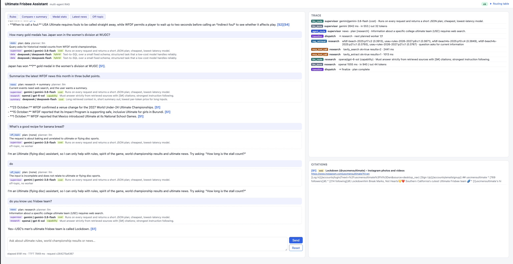

# Ultimate Frisbee Multi-Agent Assistant (CSCI 599 — Assignment 2)

A multi-agent RAG assistant for Ultimate (flying disc): official WFDF / USA Ultimate rules, WFDF world
championship medal history, and current news.

**Live service:** https://ultimate-assistant-nl5c2rxn7a-uw.a.run.app (Cloud Run, us-west1)




## Architecture at a glance

A LangGraph Supervisor (Gemini) classifies each question and makes a plan once. A pure-code `decide_next` then
dispatches to three specialist agents based on inspectable state:

- **Research** (OpenAI): Chroma vector search over 14 rule PDFs, plus Tavily Remote MCP (`tavily_search`,
  `tavily_extract`) when the corpus is not enough.
- **Data** (DeepSeek): text-to-SQL over a read-only SQLite medal database. If it finds nothing, it escalates
  to Research for a web lookup.
- **Summary** (DeepSeek): condenses the previous answer while keeping `[S#]` citations. It also calls the
  shared `tavily_extract` MCP tool.

Every LLM call has a fallback provider (OpenAI for the Supervisor, Gemini for the workers), and **Moonshot Kimi
(`kimi-k3`) is the last-resort backup for all agents**, used only if both the primary and the fallback fail. Each
call is labelled in the trace and UI with its provider and tier (primary / FALLBACK / BACKUP), so a Kimi answer is
always visible as such.

FastAPI streams tokens, trace events and citations over SSE to a vanilla HTML/JS page that shows the routing
card, the trace panel and clickable citations. See [docs/architecture.md](docs/architecture.md) for the graph,
state schema, routing table, RAG pipeline and failure handling, and [docs/evaluation.md](docs/evaluation.md)
for RAGAS, latency and cost.

**Stateless design:** every request is an independent single turn. No conversation memory is claimed, so no
Firestore/Cloud SQL is used; `session_id` is only logged.

## Setup

Requires Python 3.13 (Docker uses `python:3.13-slim`).

```bash
cd assignment_2
python3.13 -m venv .venv
.venv/bin/pip install -r requirements-dev.txt
cp .env.example .env      # then fill in the keys
```

Create the Gemini key with a **personal Gmail account**, not `@usc.edu` (Piazza #137).

## Providers

| Provider | Used by | `.env` keys | Model ID (verified 2026-10-27) |
|---|---|---|---|
| Google Gemini | Supervisor (fallback for Research/Summary/Data) | `GOOGLE_API_KEY`, `GEMINI_MODEL` | `gemini-3.8-flash` |
| OpenAI | Research, embeddings, RAGAS judge (fallback for Supervisor) | `OPENAI_API_KEY`, `OPENAI_MODEL`, `OPENAI_EMBEDDING_MODEL` | `gpt-6-sol`, `text-embedding-3-small` |
| DeepSeek | Summary, Data | `DEEPSEEK_API_KEY`, `DEEPSEEK_MODEL`, `DEEPSEEK_BASE_URL` | `deepseek-flash` @ `https://api.deepseek.com` |
| Moonshot Kimi (China endpoint) | Last-resort backup for every agent | `KIMI_API_KEY`, `KIMI_MODEL`, `KIMI_BASE_URL` | `kimi-k3` @ `https://api.moonshot.cn/v1` |
| Tavily Remote MCP | Research + Summary (shared tools) | `TAVILY_API_KEY` (passed as the `tavilyApiKey` query parameter, as PDF §3.4 specifies) | `tavily_search`, `tavily_extract` |

Each agent has a fixed primary provider, one fallback, and Kimi as a shared last-resort backup used only when both fail (Piazza #161). Every LLM call emits an `llm_route` trace
with provider, model, routing dimension (cost / capability / hybrid), reason and `fallback` flag; `/health`
returns the full routing table.

## Rebuild the corpus

The corpus is 14 English PDFs listed in `corpus/manifest.json` (`corpus_version` 2026-10-27: 13 WFDF documents
plus the USA Ultimate 2026-2027 rules), 297 pages and 1064 chunks. The original PDFs are **not** in the
submission zip (Piazza #168). The chunked text and metadata are (`corpus/chunks.jsonl`), and so is the prebuilt
index (`chroma_index/`, Piazza #167) together with `corpus/index_manifest.json` (SHA-256 of `chunks.jsonl`,
chunk count and embedding model). `tests/test_index_manifest.py` fails if the index is stale.

```bash
python -m scripts.download_corpus      # downloads every PDF (~15 MB) to corpus/raw/; network-bound
python -m scripts.ingest               # ~29 s measured: chunk PDFs -> corpus/chunks.jsonl -> embed -> chroma_index/
# or, without the PDFs, re-embed the committed chunks:
python -m scripts.ingest --from-jsonl  # ~9 s measured, ~220k embedding tokens ≈ $0.004
```

Chunking: page by page, `RecursiveCharacterTextSplitter` with 1000 characters and 150 overlap; chunks under 40
characters are dropped; each chunk is embedded as `title + text`.

## Medal dataset

`data/medals.csv` holds 300 rows (gold/silver/bronze per division) curated from Wikipedia edition articles by
`scripts/fetch_medals.py`. Every row has a `source_url`, and the data was cross-checked against each page's medal
table. Coverage: WUGC 1986/1988/1990/1994/2000/2008/2012/2016/2024, WJUC 1986–2026 (15 editions),
WU24 2013–2025 (6), WBUC 2023/2025, World Games 2001–2025 (7).

**Data gaps** (no reliable per-edition source, so deliberately not invented): WUGC 1983/1984/1992/1996/1998/2004,
WBUC 2004–2017, and all WUCC club championships. Questions about these return zero rows and escalate to web search.

```bash
python -m scripts.build_medals_db      # data/medals.csv -> data/medals.sqlite (also runs in the Docker build)
```

## Run locally

```bash
python -m scripts.build_medals_db      # once
.venv/bin/python main.py               # http://localhost:8080
```

## Tests

```bash
.venv/bin/pytest                       # 131 unit tests, no network
.venv/bin/pytest -m integration        # real OpenAI / Gemini / DeepSeek / Kimi / Tavily calls
.venv/bin/python -m scripts.smoke_test http://localhost:8080   # 6 end-to-end cases against a running server
```

## Deploy

```bash
gcloud auth login
./deploy.sh
.venv/bin/python -m scripts.smoke_test https://<service-url>
```

`deploy.sh` reads `.env`, checks that every required value is set, enables the Cloud Run, Cloud Build and
Artifact Registry APIs, builds the image with Cloud Build (`gcr.io/$GCP_PROJECT_ID/$CLOUD_RUN_SERVICE`), and
deploys with `--memory 1Gi --cpu 1 --concurrency 10 --timeout 300 --min-instances 0 --max-instances 3
--allow-unauthenticated`. Keys are passed as environment variables and are never part of the image. A new GCP
project needs billing enabled and an account with Cloud Run Admin, Cloud Build Editor and Service Account User roles.

`.gcloudignore` mirrors `.dockerignore`. It is required because without it `gcloud builds submit` falls back to
`.gitignore`, which excludes `chroma_index/`, and the image build would then fail on `test -d chroma_index`.

## Cost

Measured 2026-10-27 on the live service (details and price sources in [docs/evaluation.md](docs/evaluation.md)):
median **$0.0042 per in-domain query** (stats ≈ $0.0009, rules ≈ $0.003–0.005, news ≈ $0.005, summary ≈ $0.009;
off-topic ≈ $0.0005). A full corpus re-embedding costs about $0.004. Cloud Run scales to zero when idle. Warm
median TTFT is 4.7 s (target 3 s); the Gemini planning call (~1.8 s from us-west1) is the largest fixed cost.

## Off-topic policy

This is a domain-specific assistant (Piazza #144). Questions not about ultimate are classified `off_topic` by the
Supervisor: no worker runs, the trace shows `off-topic, no worker`, and the user gets a polite redirect with an
example question within about 2 s. Empty or over-2000-character queries are rejected with HTTP 422.

## Known limitations

- Picture-only content (hand signals, field diagrams) is not extractable as text, so those questions are refused.
- Retrieval sometimes prefers USA Ultimate or annotation chunks over the WFDF rule text (RAGAS context recall 0.48).
- The medal database has the gaps listed above; WUCC results come only from the web.
- Warm TTFT (4.7 s median) is above the 3 s target; see `docs/evaluation.md` §2 for the breakdown and trade-offs.
- Local development used Python 3.13 from Homebrew; the Docker image also uses 3.13.
