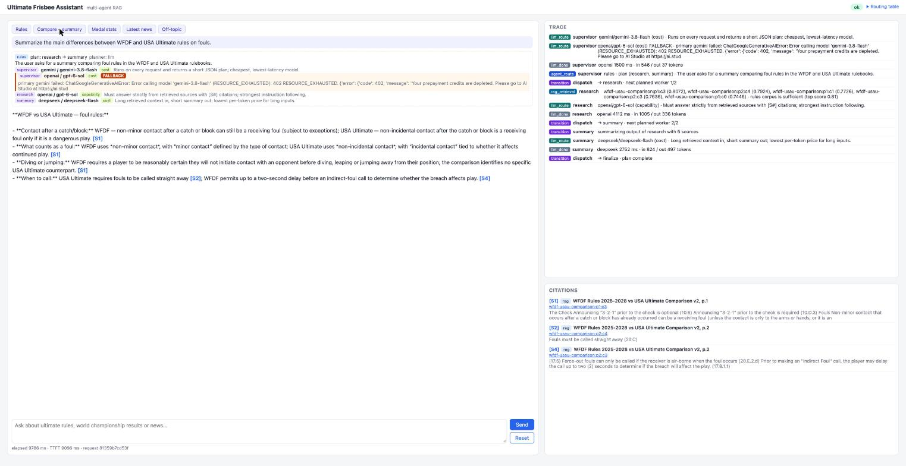
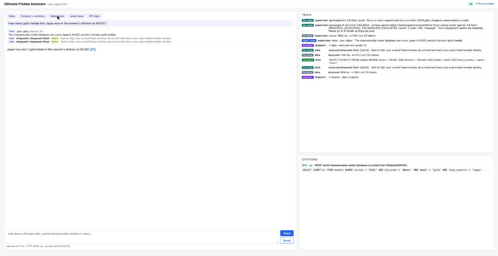
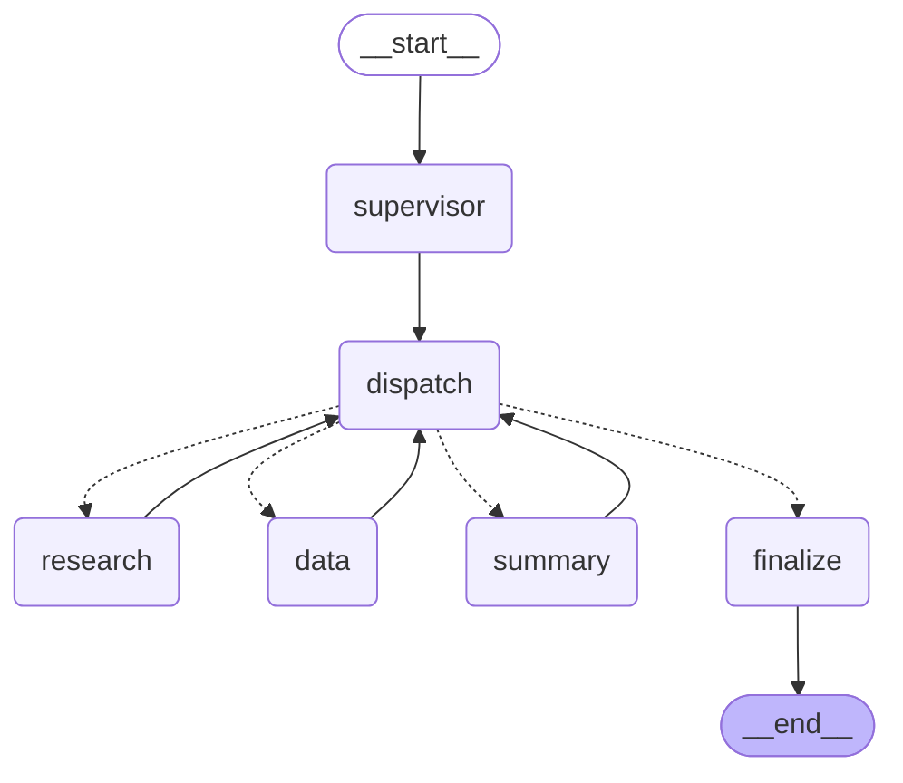
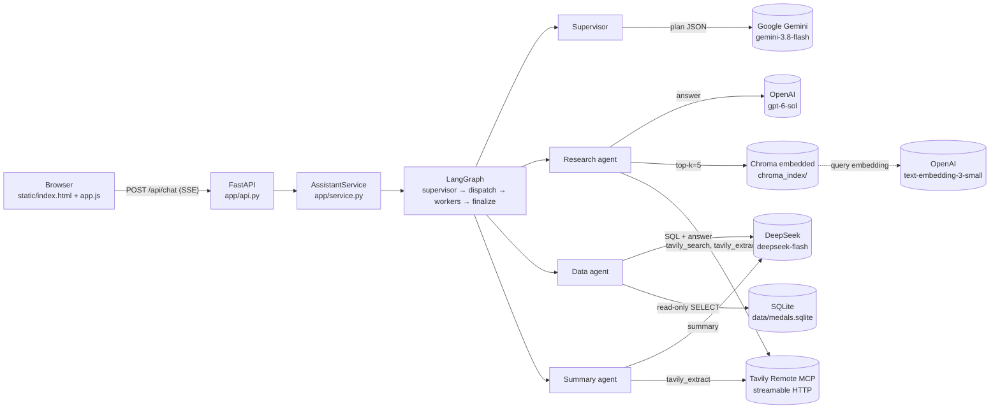

# Architecture — Ultimate Frisbee Multi-Agent Assistant

## 1. Overview

The assistant answers questions about Ultimate (flying disc): official WFDF and USA Ultimate rules, WFDF
world championship results, and current news. A LangGraph **Supervisor** classifies each question and plans
which specialist agents to run; three specialists do the work:

| Agent | Job | Tools | Provider |
|---|---|---|---|
| Research | Answer from the rulebooks with `[S#]` citations; go to the web when the corpus is not enough | Chroma vector search, Tavily `tavily_search` + `tavily_extract` (Remote MCP) | OpenAI `gpt-6-sol` |
| Data | Text-to-SQL over the medal database | Read-only SQLite (`run_sql`) | DeepSeek `deepseek-flash` |
| Summary | Condense the previous agent's answer, preserving `[S#]` labels | Tavily `tavily_extract` (Remote MCP) | DeepSeek `deepseek-flash` |

FastAPI streams every token, trace event and citation to a vanilla HTML/JS page over Server-Sent Events.





**Stateless single-turn design:** no conversation memory is claimed, so no Firestore/Cloud SQL is used
(PDF §4.4). Every `POST /api/chat` request builds a fresh graph state; `session_id` is only logged for
correlation.

## 2. Orchestration graph

Compiled LangGraph topology (exported with `build_graph(...).get_graph().draw_mermaid()`, saved in
`docs/graph.mmd`):



Components and external services:



All nodes emit custom stream events through `langgraph.config.get_stream_writer()` (`app/events.py`);
`AssistantService.stream` forwards them, and `app/api.py` frames them as SSE events named `token`,
`trace`, `citation`, `error` and `done`.

## 3. State schema

`GraphState` (`app/graph/state.py`):

| Field | Type | Written by | Read by |
|---|---|---|---|
| `query` | `str` | API input | all nodes |
| `category` | `"rules" \| "stats" \| "news" \| "off_topic"` | supervisor | dispatch, workers, finalize |
| `plan` | `list[WorkerName]` | supervisor; dispatch inserts `research` on escalation/failure and drops `summary` after a research failure | dispatch, worker nodes (`final` flag) |
| `plan_reason` | `str` | supervisor | trace / UI |
| `cursor` | `int` | supervisor (0), dispatch (advances) | dispatch, worker nodes |
| `results` | `list[WorkerResult]` (reducer: `operator.add`) | each worker node appends one | dispatch, later workers (`prior`), finalize |
| `next_node` | `str` | dispatch | conditional edge |
| `transition_reason` | `str` | dispatch | trace / UI |
| `final_answer` | `str` | finalize | service (`values` stream) |
| `final_citations` | `list[Citation]` | finalize | service |

`WorkerResult` (`app/types.py`) is the inspectable record that drives routing:

| Field | Meaning |
|---|---|
| `worker` | `research` / `data` / `summary` |
| `ok` | worker finished without an unrecoverable error |
| `output` | text produced (final answer or draft) |
| `citations` | `Citation` list: `label`, `kind` (`rag`/`web`/`sql`), `ref` (chunk_id, URL or `medals.sqlite`), `title`, `page`, `url`, `snippet` |
| `error` | short error string (no secrets, no stack trace) |
| `escalate` | Data agent asks for a web lookup (no rows, or not answerable from the schema) |
| `streamed` | output already reached the user as tokens |
| `meta` | provider, model, fallback flag, `top_score`, `web_used`, `extracted_urls`, `contexts` (for RAGAS), SQL |

## 4. Supervisor and `decide_next`

Following Piazza #166, the LLM is called **once** per request to produce `{category, plan, reason}`
(`make_plan`, Gemini). After that the pure function `decide_next` (`app/graph/supervisor.py`) picks every
hop from inspectable state, and each hop is emitted as a `transition` trace with its reason. If the planner
fails or returns invalid JSON, a fallback plan `rules / ["research"]` is used and the trace shows
`planner: "fallback"`.

`parse_plan` sanitises the LLM output: first JSON object only, valid category, only known workers, de-duplicated,
at most 3 steps, `summary` never first (research is prepended), `off_topic` forces an empty plan, and an empty
plan gets the category default (`rules`/`news` → research, `stats` → data).

`decide_next` rules (first match wins; the reason text is exactly what the trace shows):

| # | Condition | next_node | reason | plan / cursor change |
|---|---|---|---|---|
| 1 | `category == "off_topic"` | finalize | `off-topic, no worker` | unchanged |
| 2 | `len(results) >= MAX_WORKER_RUNS` (4) | finalize | `step limit reached` | unchanged |
| 3 | last result `escalate` and research has not run | research | `<last.meta.reason>; escalating to research for web lookup` | insert research at cursor, cursor+1 |
| 4 | last result failed, it was data, research has not run | research | `data failed (<error>); falling back to research` | same as 3 |
| 5 | last result failed and it was research | (continue to 7/8) | `research failed (<error>); skipping summary` | remove `summary` from the remaining plan |
| 6 | last result failed and it was summary | finalize | `summary failed (<error>); returning previous draft` | unchanged |
| 7 | `cursor < len(plan)` | `plan[cursor]` | `next planned worker <cursor+1>/<len(plan)>` (or rule 5's reason) | cursor+1 |
| 8 | otherwise | finalize | `plan complete` (or rule 5's reason) | unchanged |

Only the last worker in the plan streams tokens (`final = cursor >= len(plan)`); `finalize` streams the output
itself if the answering worker did not (e.g. summary failed and the research draft is returned).

Real traces from a local run on 2026-10-27 (the timestamp field is omitted):

**Rules question**: *"How many seconds does the marker count before a stall under WFDF rules?"*
```text
agent_route  supervisor  rules · plan [research] · "The WFDF stall count is a rulebook question."
transition   dispatch    → research · next planned worker 1/1
rag_retrieval research   wfdf-annotations-2025:p31:c2 (0.718), wfdf-rules-2025:p14:c4 (0.7152), ... web_needed=false
llm_route    research    openai/gpt-6-sol (capability)
transition   dispatch    → finalize · plan complete
answer: "Under WFDF rules, the stall count is ten seconds; ... [S2]"   citation S2 = wfdf-rules-2025:p14:c4
```

**Escalation**: *"Who won the open division at WUCC 2026?"* (the medal DB has no WUCC rows)
```text
agent_route  supervisor  news · plan [data]
transition   dispatch    → data · next planned worker 1/1
sql_query    data        SELECT team, team_country FROM medals WHERE series = 'WUCC' AND year = 2026 ... · rows=0
transition   dispatch    → research · no rows in medals DB (covers 1986-2026); escalating to research for web lookup
mcp_tool_call research   tavily_search ok=true results=5
mcp_tool_call research   tavily_extract ok=true results=1
transition   dispatch    → finalize · plan complete
answer: "San Francisco Revolver won the open division at WUCC 2026. [S7]"
```

**Summary failure**: covered by `tests/test_graph.py::test_summary_failure_returns_research_draft_as_tokens`:
the trace shows `worker_error summary`, then `transition → finalize · summary failed (...); returning previous draft`,
and the research draft is streamed by `finalize`.

## 5. Agents

| Agent | Responsibility | Tools it can use | System prompt (summary) | Provider |
|---|---|---|---|---|
| Supervisor | classify + plan | none | category definitions, agent descriptions, 7 few-shot examples, JSON-only output | Gemini (fallback OpenAI) |
| Research | grounded answer with citations | `ChunkStore.search`, `tavily_search`, `tavily_extract` | answer only from numbered sources, cite `[S#]`, say when sources do not cover it | OpenAI (fallback Gemini) |
| Data | medal statistics | `run_sql` (read-only SQLite) | schema + series codes + year range; output one SELECT or `NO_SQL`; second prompt answers from the result only | DeepSeek (fallback Gemini) |
| Summary | condense with citations | `tavily_extract` | ≤5 bullets, ≤150 words, keep every `[S#]` label, no new facts | DeepSeek (fallback Gemini) |

Research decides whether to use the web from inspectable state, recorded as `web_reason` in the
`rag_retrieval` trace: `news` category, a prior `escalate`, or a top chunk score below
`RELEVANCE_THRESHOLD = 0.50`. If web is needed but Tavily is down or `WEB_ENABLED=false`, the reason ends with
`; web unavailable` and the agent answers from RAG alone, or returns a fixed "cannot reach live web" message
without calling the LLM when nothing was retrieved.

Full prompts are in the appendix.

## 6. Routing table

| Role | Provider | Model (`.env`) | Routing dimension | Reason | Fallback | Backup |
|---|---|---|---|---|---|---|
| Supervisor (classify + plan) | Google Gemini | `GEMINI_MODEL=gemini-3.8-flash` | cost | Runs on every request and returns a short JSON plan; cheapest, lowest-latency model | OpenAI | Kimi |
| Research (RAG/web answer with citations) | OpenAI | `OPENAI_MODEL=gpt-6-sol` | capability | Must answer strictly from retrieved sources with `[S#]` citations; strongest instruction following | Gemini | Kimi |
| Summary (condense, keep citations) | DeepSeek | `DEEPSEEK_MODEL=deepseek-flash` | cost | Long retrieved context in, short summary out; lowest per-token price for long inputs | Gemini | Kimi |
| Data (text-to-SQL + explanation) | DeepSeek | `DEEPSEEK_MODEL=deepseek-flash` | hybrid | Structured task over a small fixed schema that a low-cost model handles reliably | Gemini | Kimi |
| RAGAS judge (offline only) | OpenAI | `OPENAI_MODEL` | — | evaluation only | — | — |

Per Piazza #161, binding each agent to a fixed provider is allowed: the Supervisor's choice of agent is the
routing decision. `RoutedLLM` (`app/llm/router.py`) emits an `llm_route` trace before every call (agent, provider,
model, dimension, reason, `fallback`). If the primary provider raises before any token is streamed (including
a timeout), it retries once on the fallback provider and emits a second `llm_route` with `fallback: true` and
`reason: "primary <provider> failed: <ErrorType>"` (the provider's message text is logged server-side only, since it can echo request details). Failing mid-stream does not fall back, so the user
never sees two answers spliced together. If the fallback also fails and `KIMI_API_KEY` is set, a third attempt
goes to the shared last-resort backup, Moonshot Kimi `kimi-k3` (China endpoint `https://api.moonshot.cn/v1`, OpenAI
compatible), with `tier: 2` and `reason: "fallback <provider> failed: <ErrorType>; last-resort backup after primary and
fallback failed"`. Kimi never handles requests in normal operation; it exists so that a single provider outage plus a
second failure still produces an answer. It was verified end to end by running Research with invalid OpenAI and Gemini
keys: the trace showed `openai (tier 0) → gemini (tier 1) → kimi (tier 2)` and Kimi answered. `llm_done` reports latency and token usage. The UI shows the same
data as a routing card per turn; `/health` exposes the table.

## 7. RAG pipeline

**Corpus** (`corpus/manifest.json`, `corpus_version` 2026-10-27, all English):

| Document id | Title | Version | Pages | Chunks |
|---|---|---|---|---|
| wfdf-rules-2025 | WFDF Rules of Ultimate 2025-2028 | 2025-2028 | 17 | 79 |
| wfdf-appendix-2025 | WFDF Rules 2025-2028 Appendix | v2.0 | 33 | 131 |
| wfdf-annotations-2025 | WFDF Rules 2025-2028 Official Annotations | 2026-07 | 35 | 157 |
| wfdf-beach-2025 | WFDF Rules of Beach Ultimate 2025-2028 | 2025-2028 | 18 | 81 |
| wfdf-beach4s-2025 | WFDF Rules of Beach Ultimate 4's | 2025-2028 | 22 | 90 |
| wfdf-usau-comparison | WFDF 2025-2028 vs USA Ultimate Comparison | v2 | 3 | 12 |
| wfdf-summary-of-changes | WFDF 2025-2028 Summary of Changes | 2025-2028 | 1 | 3 |
| wfdf-basic-version | WFDF Rules Basic Version | 2025-2028 | 2 | 9 |
| wfdf-hand-signals | WFDF Hand Signals | 2025-2028 | 2 | 5 |
| wfdf-decision-diagrams | WFDF Decision Diagrams | 2025-2028 | 8 | 8 |
| wfdf-championship-timings | WFDF Championship Timings | v1 | 1 | 4 |
| wfdf-game-advisor-manual | WFDF Manual for Game Advisors | v9 | 87 | 238 |
| wfdf-ga-quick-reference | WFDF Game Advisor Quick Reference | 2026 v1 | 2 | 10 |
| usau-rules-2026-2027 | USA Ultimate Official Rules 2026-2027 | 2026-2027 | 66 | 237 |
| **Total** | | | **297** | **1064** |

**Chunking:** `pypdf` extracts text page by page. Whitespace is normalised, then each page is split with
`RecursiveCharacterTextSplitter(chunk_size=1000, chunk_overlap=150, separators=["\n\n", "\n", ". ", " ", ""])`.
Chunks never cross pages, so every citation points to an exact page. Chunks shorter than 40 characters
(page numbers, headers) are dropped. `chunk_id = "<doc_id>:p<page>:c<index>"`. The output is committed as
`corpus/chunks.jsonl`.

**Embedding and store:** OpenAI `text-embedding-3-small`. The text embedded for each chunk is
`"<document title>\n<chunk text>"`, so the rulebook name (WFDF / USA Ultimate / Beach / 4s) is part of the
vector. This raised strict page-level hit@5 on the 25 eval questions from 15 to 19. Vectors are stored in
embedded Chroma (`PersistentClient`, cosine space, collection `ultimate_rules`), prebuilt into `chroma_index/`.
`corpus/index_manifest.json` records the SHA-256 of `chunks.jsonl`, the chunk count and the embedding model.
`tests/test_index_manifest.py` and `/health` fail or degrade if the shipped index is stale.

**Retrieval:** single pass (Piazza #146), **k = 5**, `score = 1 − cosine distance`.

**Augmentation prompt** (verbatim, `app/rag/answer.py`, built as an LCEL chain
`ChatPromptTemplate | RunnableLambda(RoutedLLM.call)`):

```text
System:
You are the Research agent of an Ultimate (flying disc) rules assistant.
Answer ONLY from the numbered sources below. After every sentence that uses a source,
cite it as [S1], [S2], ... using the exact labels given. If the sources do not contain
the answer, say "The provided sources do not cover this." and stop. Do not invent rule
numbers. When WFDF and USA Ultimate rules differ, say which rulebook each statement is from.
Answer in the same language as the question.

Human:
Sources:
{context}

Question: {question}
```

Each source in `{context}` is formatted as `[S1] WFDF Rules of Ultimate 2025-2028, p.14 (wfdf-rules-2025:p14:c4)`
followed by the chunk text. Web results follow the RAG chunks as `[S6] <title> (<url>)` with content truncated to
1500 characters. After generation, `used_citations` keeps only the labels that appear in the answer, in order
of first use. They are sent as `citation` events and the UI links each `[S#]` to its PDF page or URL.

## 8. MCP tool sharing

One Tavily Remote MCP connection (`app/mcp/tavily.py`, streamable HTTP, `https://mcp.tavily.com/mcp/` with the key in an `Authorization: Bearer` header, so request logs never contain it)
is discovered once at startup and shared by every agent. The rubric asks for the **same MCP tool invoked by
different agents in different contexts**, and the shared tool here is **`tavily_extract`**:

- **Research** (answering context): after `tavily_search`, it calls `tavily_extract` on the top result to
  ground the answer in the full article rather than a snippet.
- **Summary** (condensing context): when the draft it is summarising cites web sources, it calls
  `tavily_extract` on up to 2 of those URLs, so the summary is built from full text.

Every call emits `mcp_tool_call` with `node` (the calling agent), `tool`, `ok`, result count and latency.
Live trace excerpt for *"Summarize the latest WFDF news this month in three bullet points."* (local run,
2026-10-27; the deployed smoke test asserts the same thing):

```text
agent_route   supervisor  news · plan [research, summary]
mcp_tool_call research    tavily_search  ok=true results=5
mcp_tool_call research    tavily_extract ok=true results=0   (urls=1)
transition    dispatch    → summary · next planned worker 2/2
mcp_tool_call summary     tavily_extract ok=true results=2   (urls=2)
transition    summary     summarizing output of research with 10 sources
llm_route     summary     deepseek/deepseek-flash (cost)
```

We chose MCP sharing over A2A because the three agents already run in one process. A2A would add a network
hop and a second service for no functional gain, while a single MCP connection gives one discovery step,
one timeout policy and one degradation path (if Tavily is down, both agents get `[]` and an `ok=false` trace).

## 9. Data agent

**Data:** `data/medals.csv`, 300 rows (gold/silver/bronze per division) curated from Wikipedia articles for
each championship edition by `scripts/fetch_medals.py`. Every row carries a `source_url`. Covered: WUGC
1986/1988/1990/1994/2000/2008/2012/2016/2024, WJUC 1986–2026 (15 editions), WU24 2013–2025 (6), WBUC 2023/2025,
World Games 2001–2025 (7). Missing (no reliable source, deliberately not invented): WUGC
1983/1984/1992/1996/1998/2004, WBUC 2004–2017, and all WUCC editions. WUCC questions therefore escalate to web
search. `scripts/build_medals_db.py` builds SQLite at image build time.

```sql
CREATE TABLE events (event_id TEXT PRIMARY KEY, series TEXT NOT NULL, year INTEGER NOT NULL, city TEXT, host_country TEXT);
CREATE TABLE results (event_id TEXT NOT NULL REFERENCES events(event_id), division TEXT NOT NULL,
  place INTEGER NOT NULL CHECK (place IN (1, 2, 3)), team TEXT NOT NULL, team_country TEXT NOT NULL,
  source_url TEXT NOT NULL, PRIMARY KEY (event_id, division, place));
CREATE VIEW medals AS SELECT e.series, e.year, e.city, e.host_country, r.division, r.place,
  CASE r.place WHEN 1 THEN 'gold' WHEN 2 THEN 'silver' ELSE 'bronze' END AS medal, r.team, r.team_country
  FROM results r JOIN events e USING (event_id);
```

**Read-only safety** (`app/data/sql_tool.py`): the query must start with `SELECT`/`WITH`; a single statement only;
a keyword denylist (`INSERT UPDATE DELETE DROP ALTER CREATE REPLACE ATTACH DETACH PRAGMA VACUUM REINDEX TRIGGER`);
the database is opened with `file:…?mode=ro` plus `PRAGMA query_only = ON`; a 2 s progress-handler timeout; at most
200 rows returned and 50 passed to the LLM. Unsafe SQL fails immediately. A SQLite error is sent back to the
LLM once for a corrected query, and zero rows or `NO_SQL` sets `escalate=True`.

## 10. Failure handling

| Failure | Behaviour | Evidence |
|---|---|---|
| Provider error / timeout / bad key | automatic fallback provider, then the Kimi backup (`llm_route fallback=true`, `tier` 1/2, with reason); if all fail the worker returns `ok=false` and dispatch routes around it | `tests/test_router.py`, `tests/test_graph.py` |
| Unexpected exception inside a worker | caught in the worker node, converted to `ok=false` + `worker_error` trace, graph continues to `finalize` | `test_unexpected_worker_exception_does_not_crash_graph` |
| All workers failed | friendly `FAILURE_MESSAGE` streamed, no HTTP 500 | same |
| Tavily unreachable | discovery failure recorded; tools return `[]` with `mcp_tool_call ok=false`; Research answers from RAG or says live web is unavailable | `tests/test_tavily.py`, `tests/test_research_agent.py` |
| Chroma index missing/empty/stale | `store=None` (Research uses web only); `/health` reports `degraded` with the reason | `tests/test_service.py` |
| Request too slow | `asyncio.timeout(REQUEST_TIMEOUT_SECONDS=240)` yields an `error` event, always followed by `done` | `test_timeout_yields_error_then_done` |
| Empty or >2000-character query | HTTP 422 | `test_invalid_queries_are_rejected` |
| Off-topic question (Piazza #144) | Supervisor classifies `off_topic`; dispatch logs `off-topic, no worker`; a polite redirect is streamed | `test_off_topic_runs_no_worker` |

## 11. Deployment

Cloud Run (`deploy.sh`): `--memory 1Gi --cpu 1 --concurrency 10 --timeout 300 --min-instances 0 --max-instances 3`,
`--allow-unauthenticated`. The image is built by Cloud Build from a two-stage `python:3.13-slim` Dockerfile and
runs as a non-root user on `$PORT`. It contains the prebuilt `chroma_index/` (Piazza #167: rebuilding costs embedding
calls); `data/medals.sqlite` is generated from the CSV during the build, and no external API is called at build
time. `.gcloudignore` mirrors `.dockerignore`, because `gcloud builds submit` would otherwise read `.gitignore` and
drop `chroma_index/`. Secrets are passed as environment variables from the local `.env`, never baked into the image.

Cold start: the FastAPI lifespan opens Chroma, checks SQLite and discovers the Tavily MCP tools with a 20 s timeout
before serving. Every dependency degrades rather than crashing, and `/health` reports `ok` or `degraded`.

## Appendix — prompts

Supervisor (`app/graph/supervisor.py`, `SUPERVISOR_PROMPT`):

```text
You are the Supervisor of an Ultimate (flying disc) assistant. Classify the user's
question and plan which specialist agents to run, in order.

Agents:
- research: answers from the official WFDF / USA Ultimate rulebooks (vector search) and,
  when needed, live web search. Use for rules, spirit of the game, officiating, and for
  current news / upcoming or very recent events.
- data: runs SQL over a database of WFDF world championship medals (WUGC, WUCC, beach,
  U24, U20, World Games). Use for "who won", medal counts, rankings, history.
- summary: condenses the previous agent's answer into short bullet points with citations.
  Add it ONLY when the user asks for a summary, overview, comparison, or "explain simply".

Categories: rules, stats, news, off_topic. A question is off_topic when it is not about
ultimate / flying disc sports at all.

Return ONLY JSON: {"category": "...", "plan": ["..."], "reason": "<one sentence>"}

(followed by 7 few-shot examples: rules, rules+summary, stats, news→data, news, news+summary, off_topic)
```

Research: the augmentation prompt in §7.

Data, SQL generation (`DATA_SQL_PROMPT`):

```text
You are the Data agent of an Ultimate (flying disc) assistant. You translate questions
about world championship medals into ONE SQLite SELECT query.

Schema:
{ddl}

Series codes: WUGC = World Ultimate Championships (national teams), WUCC = World Ultimate
Club Championships, WBUC = World Beach Ultimate Championships, WU24 = World Under-24
Ultimate Championships, WJUC = World Junior (U20) Ultimate Championships,
WORLD_GAMES = flying disc at the World Games.
Divisions present: {divisions}
Years covered: {min_year}-{max_year}
Country names are English common names, e.g. 'United States', 'Japan', 'Great Britain'.

Rules:
- Prefer the `medals` view.
- Output only the SQL, no explanation, no Markdown fences.
- Use LIKE with wildcards for team names when the user may abbreviate.
- If the question cannot be answered from this schema, output exactly NO_SQL.
```

Data, answer (`DATA_ANSWER_PROMPT`):

```text
You are the Data agent. Answer the user's question using ONLY the SQL result below.
Cite the database as [S1] once. If the result is truncated, say so. Answer in the same
language as the question, in at most three sentences.
```

Summary (`SUMMARY_SYSTEM_PROMPT`):

```text
You are the Summary agent of an Ultimate (flying disc) assistant. You receive a draft
answer and its numbered sources. Rewrite it as a concise summary for a player:
- at most 5 bullet points, at most 150 words in total;
- keep every factual claim tied to its original [S#] label, exactly as written;
- do not add facts that are not in the draft or the sources;
- if sources disagree (e.g. WFDF vs USA Ultimate), keep both and label them.
Answer in the same language as the question.
```
